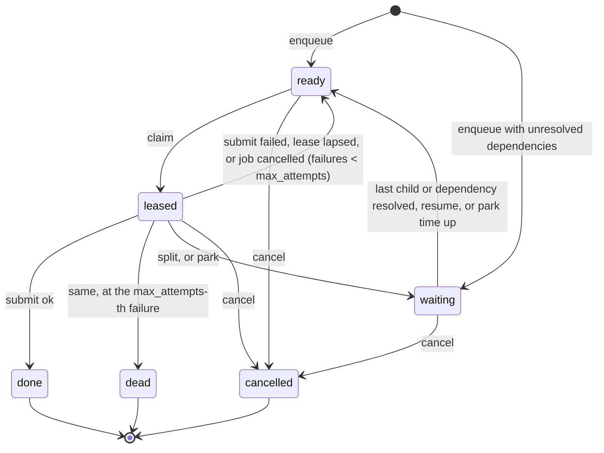

# Tessera specification, v0.2 (draft)

Status: **draft for Taylor's approval (task L1)**. Once approved, `make lock-suite` moves this file and
the tests beside it to `conformance/` and records their hashes in `conformance.lock`. After that, only
Taylor changes them.

Tessera is an atomic work queue and an atomic store for agent swarms. A backend is any implementation
that passes the tests in §10: the in-process store in `src/tessera/`, the HTTP service built from the
briefs, or anything else.

## 1. Terms

| Term | Meaning |
|---|---|
| Queue | A named list of tasks with its own lease and retry settings (§4) |
| Task | One unit of work: a JSON brief, a kind, an effect class, a priority |
| Worker | Whoever claims a task: a Muse Code run, a Claude Code session, a person |
| Lease | The right to work on one task until it lapses; at most one live lease per task |
| Fencing token | A per-task integer that rises on every claim; writes carry it, stale tokens are refused |
| Receipt | The proof of a submit: a SHA-256 over the task, token, outcome and output (§5.4) |
| Effect class | What a task may change: `read`, `write-internal`, `write-repo` or `public` |
| Key | A bearer secret for the service, scoped to queues, kinds, effect classes and admin rights |
| Dependency | A task another task waits for; the dependent becomes ready when every dependency is done, dead or cancelled |
| Park | Ending a lease without a failure while the task waits for outside input; `resume` supplies the input |

## 2. Guarantees

1. No task is ever leased to two workers at once.
2. A lease ends by submit, split, cancel, lapse or a cancelled model job; never silently.
3. A write from a stale lease is refused and changes nothing.
4. A submit is stored at most once per idempotency key, and a replay returns the first receipt.
5. Every state change, its counts update and its event commit in one transaction, or none of them do.
6. Records change only by compare-and-set; every version stays readable.
7. A task is never claimable while it waits: for its split children, for an unresolved dependency, or for
   input while parked.

## 3. Data model

One SQLite database (WAL mode) with the tables in `src/tessera/schema.sql`: `queues`, `tasks`,
`task_deps`, `task_inputs`, `leases`, `results`, `keys`, `jobs`, `events`, `counts`, plus `records`,
`record_heads` and `blobs` for storage and `meta` for housekeeping. Schema changes are additive: a database
from an earlier version gains the new columns and tables when it is opened. The same statements run on Cloudflare D1.

## 4. Queue settings

| Field | Default | Bounds | Meaning |
|---|---|---|---|
| `heartbeat_seconds` | 60 | 1 to 600 | Expected interval between heartbeats |
| `miss_limit` | 3 | 1 to 10 | Missed heartbeats before the lease lapses |
| `lease_seconds` | 600 | 1 to 3,600 | Hard cap on one lease's total length, heartbeats or not |
| `max_attempts` | 3 | 1 to 20 | Failures before dead letter |
| `backoff_base_seconds` | 30 | 0 or more | First retry delay ceiling |
| `backoff_cap_seconds` | 900 | 0 or more | Largest retry delay ceiling |
| `weight` | 1 | 1 or more | Relative share when a worker serves several queues |

Queue names match `^[a-z0-9][a-z0-9_.-]{0,63}$`. Defining an existing queue updates its settings.

## 5. Tasks and leases

### 5.1 States

A `waiting` task records why it waits (`wait_reason`): `children` after a split, `dependencies` until each
dependency is resolved, or `input` while parked.



### 5.2 Verbs

- **enqueue(spec)**: inserts a `ready` task. An explicit `task_id` that already exists in the same
  queue is a no-op that returns the id (so pipelines can re-run safely); in another queue it is refused.
  `depends_on` lists up to 100 existing task ids (an unknown id is `not_found`); while any of them is not
  done, dead or cancelled, the task is `waiting` with `pending_deps` counting them. Because a task can
  only depend on tasks that already exist, the graph has no cycles.
- **claim(queue, worker, kinds?, effect_classes?)**: first reaps lapsed leases in that queue, then
  leases the ready task with `not_before <= now`, ordered by priority (high first), then creation time,
  then id. It increments `attempts` and `fencing_token`, and sets
  `expires_at = min(now + heartbeat_seconds × miss_limit, now + lease_seconds)` and
  `hard_expires_at = now + lease_seconds`. The lease carries the brief and, for a parent back from a
  split, every child's state and successful output. Nothing ready: no lease (HTTP 204).
- **heartbeat(task, token)**: if the lease is live, sets
  `expires_at = min(now + heartbeat_seconds × miss_limit, hard_expires_at)`.
- **submit(task, token, output, idempotency_key, ok, error)**: see §5.3.
- **split(task, token, children)**: creates 1 to 100 child tasks (`ready`, `parent_id` set; queue, kind,
  effect class and priority default to the parent's), ends the parent's lease and moves the parent to
  `waiting` with `pending_children` = the number of children. Nesting stops at 4 levels. A child's
  `after` lists indexes of earlier children it depends on, so a split can run in ordered waves; an index
  that isn't earlier is `invalid_request`. A child's effect class may not be broader than its parent's
  (`read` < `write-internal` < `write-repo` < `public`): splitting never widens what work may change.
- **park(task, token, reason, resume_within?)**: needs the live lease. Ends it without counting a failure,
  asks the task's running model jobs to stop, and moves the task to `waiting` for `input`. With
  `resume_within` (up to 30 days) the reaper brings it back after that many seconds with the input
  `{"timed_out": true}`.
- **resume(task, input)**: only for a parked task (otherwise `invalid_state`). Stores the input (up to
  1 MiB) and makes the task `ready`. Its next lease carries every input it has received, in order. The
  task records the key that parked it; that key may not resume it (`forbidden`), so outside input comes
  from someone else. Admin keys may. The `resumed` event records the resuming key. Each park raises the
  task's `parks` count; a resume may name the park it answers (`park`), and is refused with
  `invalid_state` if the task has moved on to a later park.
- **Leases** carry the brief plus `children` (after a split), `dependencies` and `inputs`: each child or
  dependency with its state and latest successful output. A dead or cancelled dependency still releases
  its dependent, which sees what happened and decides.
- **cancel(task, reason)**: moves a non-terminal task to `cancelled`, ends its lease, marks its running
  model jobs `cancel_requested`, cancels its unfinished descendants, and counts as resolved for its
  parent.

A lease is **live** while its token is the task's current token and `now < expires_at` and
`now < hard_expires_at`. Any verb that finds the caller's lease not live answers `stale_lease`; if the
lease has just lapsed, the lapse is processed (§5.3) before answering.

### 5.3 Outcomes, retries and dead letter

- `ok = true`: the task becomes `done`; its parent, if any, counts one more child resolved.
- `ok = false`, a lapse, or a model job cancelled under the live lease: `failures` rises by one. At
  `failures >= max_attempts` the task becomes `dead` (and counts as resolved for its parent). Otherwise
  it becomes `ready` with `not_before = now + delay`, where
  `delay = min(backoff_cap_seconds, backoff_base_seconds × 2^(failures − 1)) × u` and `u` is drawn
  uniformly from [0.5, 1.0].
- When a parent's `pending_children` reaches 0 while `waiting`, the parent becomes `ready` for the merge.
- The reaper (`reap`) processes every lapsed lease, wakes parked tasks whose time is up, and records its
  run time; the service runs it at least once a minute. Claims do both for their own queue first.
- When a task becomes done, dead or cancelled, every task depending on it counts one dependency resolved.

### 5.4 Idempotency and receipts

Idempotency keys are global. A submit whose key was already used for the same task returns the first
receipt with `replayed = true` and writes nothing; for a different task it is refused
(`idempotency_conflict`). Every submit, failed ones included, stores one result row. The receipt hash is

```
sha256( canonical_json({"task_id", "fencing_token", "ok", "output", "error"}) )
```

where `canonical_json` sorts keys, uses `,` and `:` without spaces, keeps UTF-8, rejects NaN, and writes a
whole number without a fraction (`1.0` as `1`, below 2^53), so a receipt computed in another language, such
as JavaScript, matches.
Outputs above 1 MiB are refused: store the bytes as a blob and submit its hash.

### 5.5 Counts, events and health

- **Counts**: one row per queue with `ready`, `leased`, `waiting`, `done`, `dead`, `cancelled`,
  updated in the transaction that changes a task's state. `recount` recomputes them from `tasks`; the
  two must always agree. Every board and manifest reads counts, never its own tally.
- **Events**: an append-only log with a rising `seq`: `queue_defined`, `enqueued`, `claimed`,
  `heartbeat`, `submitted`, `retry_scheduled`, `dead_lettered`, `lease_lapsed`, `split`,
  `parent_ready`, `dependencies_met`, `parked`, `resumed`, `park_expired`, `cancelled`,
  `jobs_cancel_requested`, `job_registered`, `job_updated`, `records_written`, `blob_stored`,
  `bucket_defined`, `object_stored`, `key_issued`, `key_revoked`. Read in pages of up to 10,000 after a given `seq`. An event never
  holds a key, a resume input or an output; it names the task, the worker and the token.
- **Health**: `db_ok`, version, time, the reaper's last run, and per queue the counts, the age of the
  oldest claimable ready task and the number of expired leases not yet reaped.

## 6. Model jobs and atomic storage

- **Jobs**: `register_job(task, token, job_id, model)` needs a live lease; `update_job(job_id, status,
  usage, cost_usd)` records progress. Statuses follow the Meta Model API's background responses
  (`queued`, `in_progress`, `completed`, `failed`, `cancelled`, `incomplete`) plus `cancel_requested`,
  which Tessera sets when a lease lapses or a task is cancelled. A job reported `cancelled` under the
  live lease returns its task as a failure (§5.3). Whoever runs the model lane polls Meta and reports
  back; Tessera itself never calls a model.
- **Records**: `put_record(store, key, value, expected_version)` writes version `head + 1` only if the
  head is still `expected_version` (`None` means the key must not exist); otherwise `version_conflict`
  with the current version. Every version is kept (`record_history`); `get_record` reads the head or a
  given version; `stores` and `list_records(store, prefix, limit)` query existing stores and head keys.
  `put_records` applies a batch in one transaction: all writes or none.
- **Blobs & buckets**: `put_blob(bytes)` stores up to 16 MiB under its SHA-256 and returns it; storing
  the same bytes again is a no-op. `get_blob` verifies the hash before returning. `define_bucket` and
  `buckets` organize content-addressed files into named buckets (`nouns`, `verbs`, `kits`, `cases`,
  `provisions`, `traces`), and `put_object(bucket, key, bytes, expected_version)` / `get_object` /
  `list_objects` / `object_history` maintain compare-and-set versioned files with SHA-256 verification.

## 7. HTTP service

Every write is a POST with `Authorization: Bearer <key>`. A GET on a write path answers 405 and changes
nothing. Bodies are JSON. Successful bodies are the models in `src/tessera/models.py`.

| Method and path | Body | Success | Needs |
|---|---|---|---|
| POST /v1/queues/define | QueueConfig | 200 QueueConfig | admin |
| GET /v1/queues | | 200 `{queues}` | any key |
| POST /v1/tasks | TaskSpec | 201 `{task_id}` | key for the queue, and for each dependency's queue |
| GET /v1/tasks/{id}, GET /v1/tasks/{id}/results | | 200 TaskView, `{results}` | key for the queue |
| POST /v1/tasks/claim | `{queue, worker, kinds?, effect_classes?}` | 200 Lease, or 204 with Retry-After | key for the queue, kind and effect class |
| POST /v1/tasks/heartbeat | `{task_id, fencing_token}` | 200 Lease | the key that claimed |
| POST /v1/tasks/submit | `{task_id, fencing_token, output, ok, error}` + `Idempotency-Key` header | 200 Receipt | the key that claimed |
| POST /v1/tasks/split | `{task_id, fencing_token, children}` | 200 `{children}` | the key that claimed, holding each child's effect class |
| POST /v1/tasks/park | `{task_id, fencing_token, reason, resume_within?}` | 200 TaskView | the key that claimed |
| POST /v1/tasks/resume | `{task_id, input, park?}` | 200 TaskView | key for the task's queue, other than the key that parked it |
| POST /v1/tasks/cancel | `{task_id, reason}` | 200 TaskView | key with the task's effect class |
| POST /v1/admin/reap | | 200 `{reaped}` | admin |
| GET /v1/counts (`?recount=true`) | | 200 `{as_of, queues}` | any key |
| GET /v1/health | | 200 Health | none |
| GET /v1/events (`?after=&limit=`) | | 200 `{events}` | admin |
| POST /v1/jobs, POST /v1/jobs/{id}, GET /v1/jobs (`?task_id=`) | | 201 Job, 200 Job, 200 `{jobs}` | the key that claimed |
| GET /v1/stores, GET /v1/stores/{store}/records (`?prefix=&limit=`) | | 200 `{stores}`, `{records}` | key with store scope |
| POST /v1/stores/{store}/records/{key} | `{value, expected_version}` | 200 RecordVersion | key with store scope |
| POST /v1/stores/batch | `{writes}` | 200 `{records}` | key with store scope |
| GET /v1/stores/{store}/records/{key} (`?version=`), `/history` | | 200 RecordVersion, `{versions}` | key with store scope |
| POST /v1/buckets/define, GET /v1/buckets | BucketConfig | 200 BucketInfo, `{buckets}` | key with store scope |
| POST /v1/buckets/{bucket}/objects/{key} (raw bytes) | `?expected_version=` | 201 ObjectMeta | key with store scope |
| GET /v1/buckets/{bucket}/objects (`?prefix=`), `/objects/{key}` (`?version=&meta=&history=`) | | 200 `{objects}`, bytes / ObjectMeta / `{versions}` | key with store scope |
| POST /v1/blobs (raw bytes) | | 201 `{sha256, size}` | key with store scope |
| GET /v1/blobs/{sha256} | | 200 bytes | key with store scope |
| POST /v1/admin/keys, GET /v1/admin/keys, POST /v1/admin/keys/{id}/revoke | IssueKeyBody | 201 key+KeyGrant, 200 `{keys}`, KeyGrant | admin |
| POST /mcp | MCP over Streamable HTTP | | any key |
| GET /board | | 200 HTML, read-only, reads `/v1/counts` | none |

- **Keys**: random, at least 32 bytes; stored only as SHA-256; scoped to queues, kinds, effect classes
  and scopes (`admin`, `store`); expire after 14 days; revocable; issued from the command line.
  No key may hold the `public` effect class without a fresh, single-use approval token from Taylor.
- **Limits**: 60 claims a minute per key, then 429 with `Retry-After`. Throttled and empty answers
  carry `Retry-After` plus the queue's heartbeat interval.
- **MCP**: tools `queues`, `claim`, `heartbeat`, `submit`, `split`, `park` and `resume` with typed input
  and output schemas, behind the same keys. Tool results carry the same JSON as the HTTP bodies.
- **Hygiene**: no key, token or credential appears in any response, page or log. CORS allows only
  listed origins, never `*`. Pages carry no instructions aimed at visiting agents.
- **Edge lockdown**: when `TESSERA_EDGE_SECRET` is set, every request except `GET /v1/health` and
  `GET /healthz` must carry an `x-edge-auth` header equal to it (compared in constant time), else 403
  `forbidden`. The Cloudflare edge adds the header, so the origin answers only through the edge.

## 8. Errors

Errors are `application/problem+json`: `{"type": "about:blank", "title", "status", "detail", "code"}`,
plus `current_version` for `version_conflict`.

| Code | Status | When |
|---|---|---|
| `invalid_request` | 400 | Bad body, unknown field, limit exceeded |
| `unauthorized` | 401 | No key, or an unknown, expired or revoked key |
| `forbidden` | 403 | The key's scope doesn't cover the queue, kind, effect class or store |
| `not_found` | 404 | Unknown queue, task, job, record or blob |
| `method_not_allowed` | 405 | GET (or another method) on a write path |
| `stale_lease` | 409 | The caller's lease isn't live |
| `version_conflict` | 409 | Compare-and-set lost |
| `idempotency_conflict` | 409 | The idempotency key belongs to another task |
| `invalid_state` | 409 | The task isn't in a state that allows this, for example resuming a task that isn't parked |
| `rate_limited` | 429 | Over the claim rate |
| `unavailable` | 503 | Overloaded or shutting down; retry after `Retry-After` |

## 9. Limits

Output 1 MiB per submit; resume input 1 MiB; blob 16 MiB; 100 children per split; 100 dependencies per
task; parks up to 30 days; 4 levels of nesting; 10,000 events per page; task ids `^[A-Za-z0-9][A-Za-z0-9_.:-]{0,127}$`; record keys `^[A-Za-z0-9][A-Za-z0-9_.:-]{0,255}$`.

## 10. Conformance

| Test | Proves | Applies to |
|---|---|---|
| T01 | Keys are required; a key for another queue gets 403 | service |
| T02 | Writes are POST-only; GET on a write path is 405 and changes nothing | service |
| T03 | 8 workers race for 1,000 claims; no task is leased twice | every backend |
| T04 | Missed heartbeats lapse a lease; the task returns with a higher token; heartbeats keep a lease; the hard cap holds | every backend |
| T05 | The old holder's submit after a re-lease is refused; the new holder's succeeds | every backend |
| T06 | The third failure dead-letters the task, every attempt logged; backoff stays in bounds | every backend |
| T07 | The same submit twice stores one result; a key reused for another task is refused | every backend |
| T08 | Split keeps the parent waiting, then returns it with the children's results | every backend |
| T09 | After 500 mixed outcomes, counts equal a recount | every backend |
| T10 | Health reports the database, the reaper's last run and queue depths | every backend |
| T11 | An MCP client initializes, lists the four tools, claims and submits | service |
| T12 | Model jobs carry cost; a cancelled job returns its task; a lapse asks jobs to stop | every backend |
| T13 | 4 workers move 50 tasks through 2 queues: none lost, none doubled, all receipted | every backend |
| T14 | A restart mid-run loses and doubles nothing | every backend |
| T15 | Every receipt matches its stored result under §5.4's formula | every backend |
| T16 | No key appears in responses, pages or logs | service |
| T17 | A dependent waits for every dependency, then carries their results; dead or cancelled dependencies release it; unknown ones are refused | every backend |
| T18 | Children with `after` run in waves | every backend |
| T19 | Park ends a lease with no failure; resume brings the task back with its input; only the live lease may park; a parked task wakes when its time is up | every backend |
| T20 | A split child is never broader than its parent | every backend |
| T21 | The key that parked a task may not resume it; the resume records its key | service |
| ST01 to ST04 | Compare-and-set has one winner; history is kept; blobs are content-addressed; batches are atomic | every backend |

`make suite BACKEND=store` runs the suite on the in-process store; `make suite BACKEND=http` runs it on
the service at `TESSERA_URL` (see `README.md` in this folder). `make suite-stub` proves the suite fails
against an empty backend. A backend carries real work only when every test that applies to it passes.
