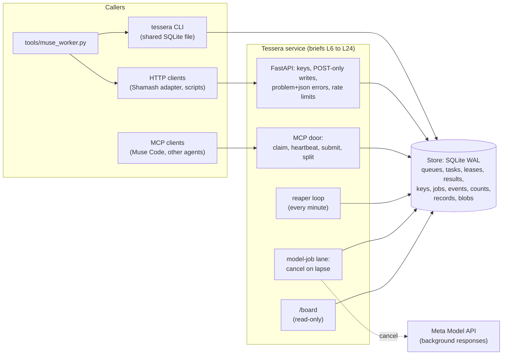

# Architecture

Tessera has one store and several doors. Every door ends in the same IMMEDIATE transaction, so the
guarantees in SPEC.md hold whichever way work comes in.

- **Store** (`src/tessera/`): the reference implementation and the only place state changes. One
  connection per thread; every write is one IMMEDIATE transaction that also updates `counts` and appends
  to `events`. Several processes may share the file.
- **Service**: a thin layer that adds keys, scopes, POST-only writes, rate limits and the MCP door. It
  calls the store and nothing else.
- **Model-job lane**: Tessera never calls a model for work; the worker that holds the lease does. Tessera
  records the job against the lease and, when the lease lapses, asks Meta to cancel it.
- **Board**: reads the counts record and nothing else, so every board shows the same numbers.

## Two loops on one fabric

- **Build loop**: briefs for this repo and Shamash sit on queue `build`; Muse Code workers claim them
  with `tools/muse_worker.py`, work in their own git worktree, and submit receipts.
- **Run loop**: Shamash's cases move through `aq02`, `aq85`, `aq04`, `aq05` and `aq86`.

Both loops write the same event log, which is the making-of (docs/making-of.md).
