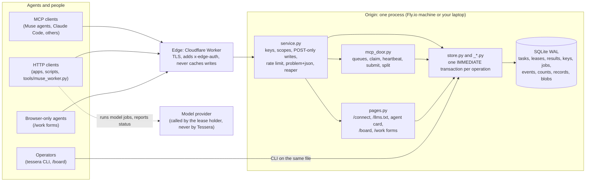
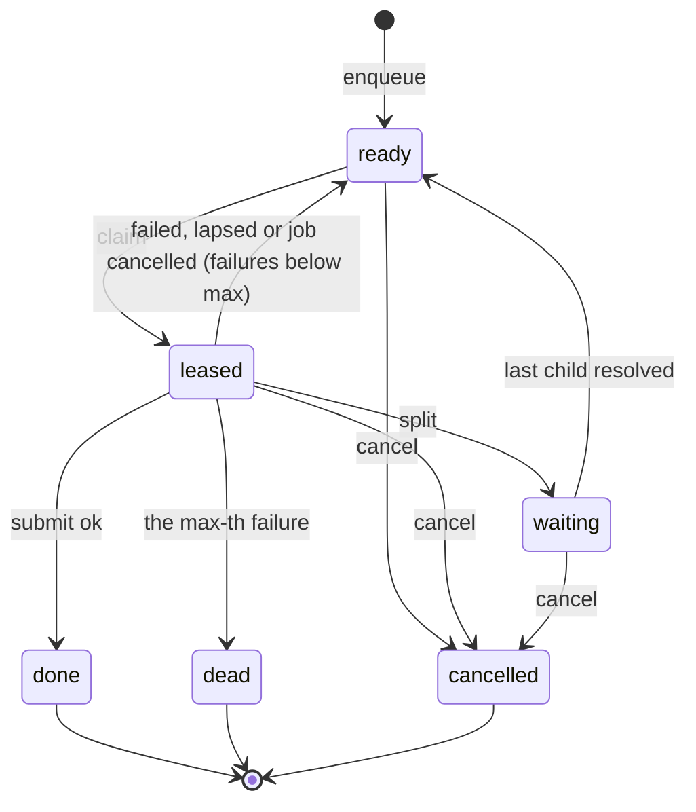
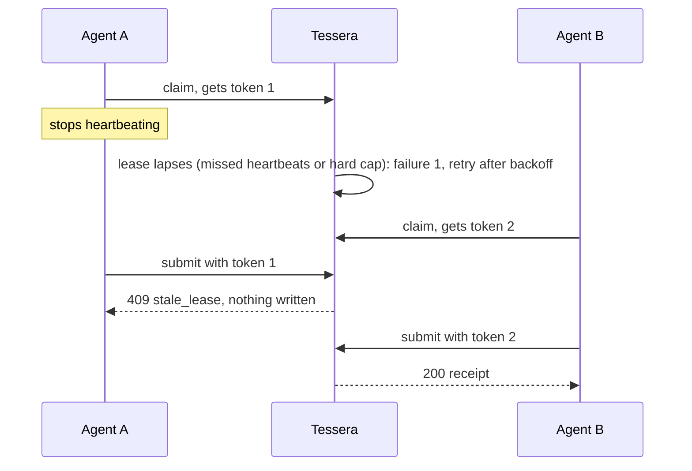

# Tessera: architecture

Tessera has one store and several doors. Every door ends in the same `BEGIN IMMEDIATE` transaction on one
SQLite file, so the guarantees in [SPEC.md](../conformance-draft/SPEC.md) hold whichever way work comes in.
The same structure is written as data in [architecture.json](../architecture.json), which `make architecture`
checks against the code (paths, tests, layering). `python3 scripts/check_architecture.py --mermaid` prints the
component graph.

## Context



## Components

| Component | Path | Role | Depends on |
|---|---|---|---|
| Models | `src/tessera/models.py` | Pydantic records that cross the boundary: what callers send, what every backend returns | pydantic |
| Errors | `src/tessera/errors.py` | One exception class per problem code; each maps to one HTTP status (SPEC §8) | none |
| Receipts | `src/tessera/receipts.py` | Canonical JSON and the receipt hash (SPEC §5.4) | none |
| Clock | `src/tessera/clock.py` | Time source; tests inject a fake clock so lapses need no sleeping | none |
| Store | `src/tessera/store.py`, `_base.py`, `_tasks.py`, `_jobs.py`, `_keys.py`, `_observe.py`, `_storage.py`, `schema.sql` | The reference implementation: queues, the five verbs, retries, split, model jobs, keys, counts, events, health, records and blobs | models, errors, receipts, clock |
| Backend protocol | `src/tessera/backend.py` | The contract every backend meets (Store, Client, adapters) | models |
| HTTP client | `src/tessera/client.py` | A Backend over HTTP, so callers can switch store and service with one setting | models, errors, httpx |
| Service | `src/tessera/service.py` | FastAPI app: bearer keys, scopes, POST-only writes, claim rate limit, problem+json, edge lock, the reaper loop | store, MCP door, pages |
| MCP door | `src/tessera/mcp_door.py` | MCP server over Streamable HTTP at `/mcp`, behind the same keys | store, keys |
| Agent pages | `src/tessera/pages.py` | `/connect`, `/llms.txt`, `/.well-known/agent-card.json`, `/robots.txt`, `/board`, keyed `/work` forms | store |
| CLI | `src/tessera/cli.py` | `tessera` command: every verb on a shared SQLite file, plus `serve` and `keys` | store, service |
| Conformance suite | `conformance-draft/` | SPEC.md and tests T01 to T16, ST01 to ST04, run against any backend by factory name | backend protocol |
| Edge | `deploy/cloudflare/worker.js` | Reverse proxy: adds `x-edge-auth`, strips cookies and hop-by-hop headers, security headers, `no-store` on writes | none |
| Tools | `tools/seed.py`, `tools/load_briefs.py`, `tools/muse_worker.py` | Seed queues and keys; queue briefs whose dependencies are done; run one Muse Code worker on one brief | client or store |

## Layering

Three rules keep the store usable on its own and the doors thin. `make architecture` fails if an import breaks one.

1. **The store never imports the web.** `models`, `errors`, `receipts`, `clock`, `backend` and every store
   module import nothing from FastAPI, Starlette, Uvicorn, httpx, MCP or the service modules.
2. **The client never touches the database.** `client.py` imports no store module and no `sqlite3`.
3. **Every door calls the store and nothing else** for state. The service, the MCP door and the pages add
   keys, limits and formatting; none writes SQL.

## Data

One SQLite database in WAL mode (`src/tessera/schema.sql`), `busy_timeout` 30 s, one connection per thread:

| Table | Holds |
|---|---|
| `queues` | Queue settings: heartbeat, miss limit, lease cap, attempts, backoff, weight |
| `tasks` | One row per task: queue, kind, effect class, priority, brief, state, attempts, failures, fencing token, parent, pending children, not-before |
| `leases` | The live lease per task: token, worker, key, expiry, hard expiry |
| `results` | Every submit, failed ones included, with its receipt hash |
| `keys` | Worker keys as SHA-256 hashes, with scopes, expiry and revocation |
| `jobs` | Model jobs tied to a task and the fencing token that started them, with usage and cost |
| `events` | The append-only log with a rising `seq` |
| `counts` | One row per queue: ready, leased, waiting, done, dead, cancelled |
| `records`, `record_heads` | Every version of every record, and the head version per key |
| `blobs` | Bytes under their SHA-256, up to 16 MiB |
| `meta` | Housekeeping, such as the reaper's last run |

Every state change, its `counts` update and its `events` row commit in one transaction or not at all.

## Task states



## Main flows

### Claim, heartbeat, submit

```mermaid
sequenceDiagram
  participant A as Agent (key K)
  participant E as Edge
  participant S as Service
  participant D as SQLite
  A->>E: POST /v1/tasks/claim {queue, worker}
  E->>S: same request + x-edge-auth
  S->>S: K valid, queue in scope, under the claim rate?
  S->>D: BEGIN IMMEDIATE: reap lapsed leases in the queue, take the next ready task,<br/>attempts+1, token+1, write lease, counts, event; COMMIT
  S-->>A: 200 Lease {task_id, fencing_token, brief, expires_at} (or 204 + Retry-After)
  loop while working
    A->>S: POST /v1/tasks/heartbeat {task_id, fencing_token}
    S->>D: extend expires_at, never past the hard cap
  end
  A->>S: POST /v1/tasks/submit {task_id, fencing_token, output, ok} + Idempotency-Key
  S->>D: BEGIN IMMEDIATE: lease live? key already used? store result, task done,<br/>counts, event; COMMIT
  S-->>A: 200 Receipt {receipt_hash, replayed}
```

### A stalled agent comes back late



### Split and merge

A lease holder splits its task into 1 to 100 children (up to 4 levels deep). The parent's lease ends and the
parent waits. When the last child resolves (done, dead or cancelled), the parent becomes ready again, and its
next claim carries every child's state and successful output, so one worker can merge them.

### Model jobs

Tessera never calls a model. The agent holding the lease starts a background job with its provider, registers
it (`POST /v1/jobs`, needs the live lease) and reports progress, usage and cost. When the lease lapses or the
task is cancelled, Tessera marks the job `cancel_requested`; a job reported `cancelled` under the live lease
returns its task as a failure.

## Invariants

Each invariant names the tests that check it; [architecture.json](../architecture.json) holds the exact test
references.

| Id | Always true | Checked by |
|---|---|---|
| I1 | No task is leased to two workers at once | T03 |
| I2 | A lease ends only by submit, split, cancel, lapse or a cancelled job; a lapsed task returns with a higher token | T04 |
| I3 | A write from a stale lease is refused and changes nothing | T05 |
| I4 | Failures retry with bounded jittered backoff, then dead-letter, every attempt logged | T06 |
| I5 | One stored result per idempotency key; a replay returns the first receipt | T07 |
| I6 | A split parent waits, then returns with its children's results | T08 |
| I7 | The counts record always equals a recount | T09 |
| I8 | Nothing is lost or doubled across workers, queues and restarts | T13, T14 |
| I9 | Every receipt hash matches its stored result | T15 |
| I10 | No key appears in any response, page or log | T16 and service tests |
| I11 | Records change only by compare-and-set and keep every version; blobs are content-addressed; batches are atomic | ST01 to ST04 |
| I12 | Only the key that claimed a task may change it, and tasks with the `public` effect class never reach an agent | service tests |

## Trust boundaries

| Boundary | Rule | Enforced by |
|---|---|---|
| Internet to edge | TLS; cookies stripped; writes never cached | `deploy/cloudflare/worker.js` |
| Edge to origin | With `TESSERA_EDGE_SECRET` set, every request except the health checks must carry a matching `x-edge-auth` (constant-time compare), else 403 | `service.py`, tested by `test_the_edge_lock` |
| Caller to service | Bearer key required; scoped to queues (globs), kinds, effect classes and `admin` or `store`; 60 claims a minute per key; writes are POST-only | `service.py`, `_keys.py`, tests T01, T02 and the service tests |
| Lease holder to task | Heartbeat, submit and split need the claiming key and the current fencing token | `_tasks.py`, `service.py` |
| Service to model provider | None: Tessera holds no model key and makes no model call | by construction; `MODEL_API_KEY` is only for workers |

Keys are random 32-byte secrets, printed once when issued and stored only as SHA-256. They expire after 14 days
and can be revoked at once. No key may hold the `public` effect class.

## Failure handling

| What fails | What happens |
|---|---|
| An agent dies or stalls | Its lease lapses after missed heartbeats or the hard cap; the task retries with backoff; a late submit is refused |
| The same submit arrives twice | The second returns the first receipt with `replayed = true` and writes nothing |
| A task keeps failing | It dead-letters at `max_attempts` (3 by default); every attempt is in `results` and `events` |
| The process restarts | State is in SQLite; leases keep their expiry; the reaper returns lapsed ones (T14) |
| Two writers at once | SQLite serializes them; `busy_timeout` waits up to 30 s instead of failing |
| An agent claims too fast | 429 with `Retry-After` |
| The queue is empty | 204 with `Retry-After` plus the heartbeat interval |
| Someone reaches the origin directly | 403 without the edge secret, except health checks |

## Deployment

| Where | How | Parts |
|---|---|---|
| Local | `make dev` | Service on 127.0.0.1:7700, the real Worker code under `wrangler dev` on 127.0.0.1:7701, a per-run edge secret |
| Local, reachable from the web | `make dev TUNNEL=1` | The same plus a temporary `*.trycloudflare.com` address (no account, no uptime promise) |
| Hosted | `deploy/bootstrap-hosting.sh`, then the GitHub `deploy` workflow with approval | Cloudflare Worker `tessera` in front of Fly.io app `tessera-fabric`, SQLite on a 1 GB volume, one always-on machine for the reaper |

## Two loops on one fabric

Tessera's first user is [Shamash](https://github.com/ta-amps/shamash), which runs two loops on it. In the
**build loop**, briefs for both repos sit on queues and Muse Code workers claim them in their own git worktrees.
In the **run loop**, Shamash's cases move through five queues. Both write the same event log, which becomes the
making-of ([making-of.md](making-of.md)). Nothing in Tessera knows about either loop; see
[generalizing.md](generalizing.md).
