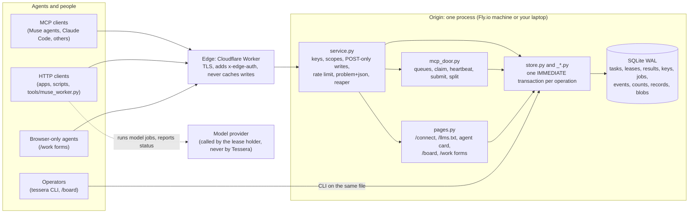
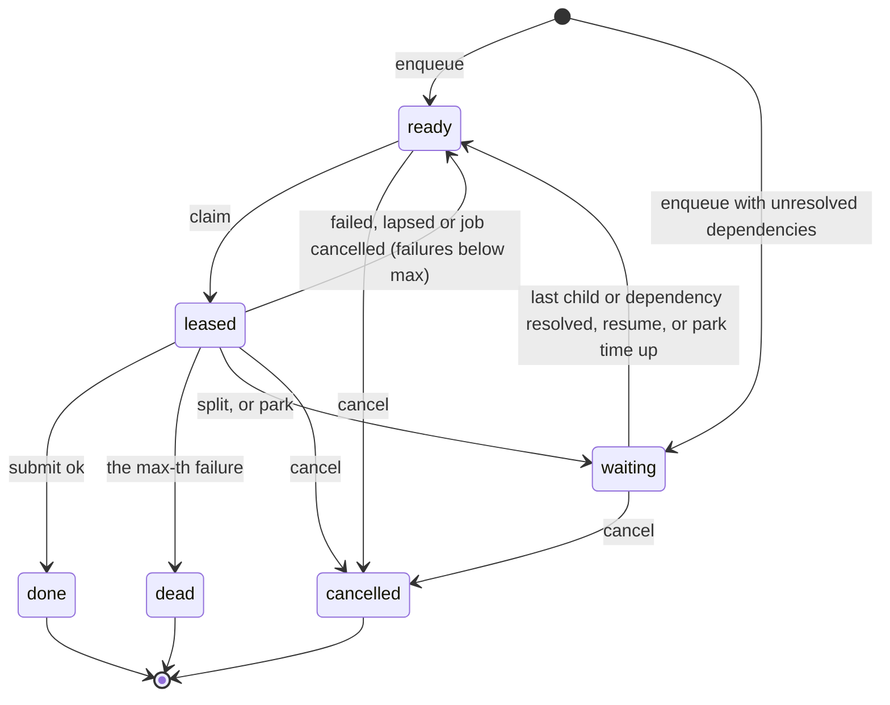
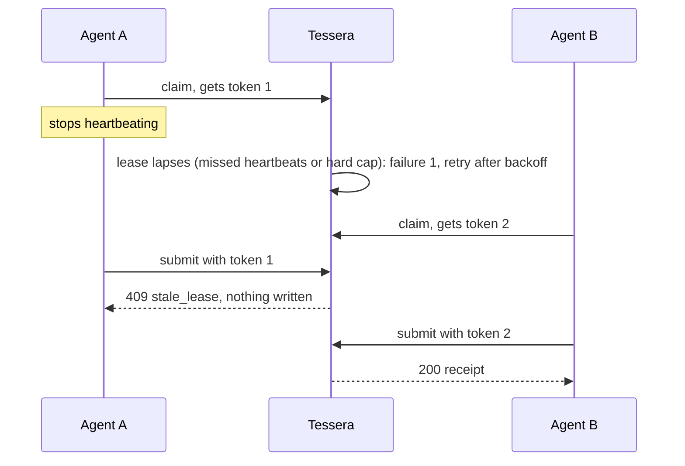
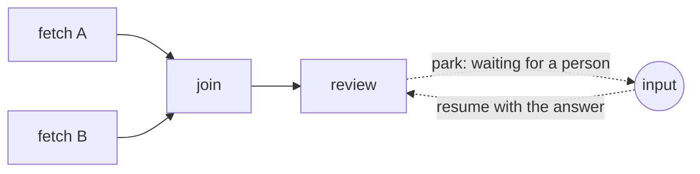

# Tessera: architecture

Tessera has one coordination authority per backend and several doors. Local Python
uses SQLite transactions; the native cloud backend uses a namespace-scoped SQLite
Durable Object. The diagram below describes the local/origin path. Read
[Nouns, verbs and evidence](work-design-and-evidence.md) for the current cloud/local
distinction, review strategy, guarantees and limits alongside the
[draft spec](../conformance-draft/SPEC.md).
The same structure is written as data in [architecture.json](../architecture.json), which `make architecture`
checks against the code (paths, tests, layering). `python3 scripts/check_architecture.py --mermaid` prints the
component graph.

## Context



## Components

| Component | Path | Role | Depends on |
|---|---|---|---|
| Models | `src/tessera/models.py` | Pydantic records that cross the boundary: what callers send, what every backend returns | pydantic |
| Errors | `src/tessera/errors.py` | One exception class per problem code; each maps to one HTTP status (SPEC §8) | none |
| Receipts | `src/tessera/receipts.py` | Canonical JSON and the receipt hash (SPEC §5.4) | none |
| Clock | `src/tessera/clock.py` | Time source; tests inject a fake clock so lapses need no sleeping | none |
| Store | `src/tessera/store.py`, `_base.py`, `_tasks.py`, `_graph.py`, `_jobs.py`, `_keys.py`, `_observe.py`, `_storage.py`, `schema.sql` | The reference implementation: queues, the five verbs, park and resume, dependencies, retries, split, model jobs, keys, counts, events, health, records and blobs | models, errors, receipts, clock |
| Backend protocol | `src/tessera/backend.py` | The contract every backend meets (Store, Client, adapters) | models |
| HTTP client | `src/tessera/client.py` | A Backend over HTTP, so callers can switch store and service with one setting | models, errors, httpx |
| Service | `src/tessera/service.py`, `access.py` | FastAPI app: routes, POST-only writes, problem+json, edge lock, the reaper loop. `access.py` holds what every door shares: settings, the claim limiter, the bearer key, the Gate | store, MCP door, pages |
| Key grants | `src/tessera/grants.py` | What a key may do and how a request is narrowed to it: pure policy shared by the store and every door | models |
| MCP door | `src/tessera/mcp_door.py` | MCP server over Streamable HTTP at `/mcp` (claim, heartbeat, submit, split, park, resume), behind the same keys | store, keys |
| Agent pages | `src/tessera/pages.py` | `/connect`, `/llms.txt`, `/.well-known/agent-card.json`, `/robots.txt`, `/board`, keyed `/work` forms | store |
| CLI | `src/tessera/cli.py` | `tessera` command: every verb on a shared SQLite file, plus `serve` and `keys` | store, service |
| Conformance suite | `conformance-draft/` | SPEC.md and tests T01 to T16, ST01 to ST04, run against any backend by factory name | backend protocol |
| Edge | `deploy/cloudflare/worker.js` | Reverse proxy: adds `x-edge-auth`, strips cookies and hop-by-hop headers, security headers, `no-store` on writes | none |
| Tools | `tools/seed.py`, `tools/load_briefs.py`, `tools/muse_worker.py` | Seed queues and keys; queue briefs whose dependencies are done; run one Muse Code worker on one brief | client or store |

## Layering

Tessera is built in rings, innermost first. A ring may use the rings inside it and never the ones outside;
`make architecture` checks every rule against the real imports (`import_rules` in architecture.json).

| Ring | Modules | May use |
|---|---|---|
| 0 Kernel | `models.py`, `errors.py`, `receipts.py`, `clock.py`, `grants.py`, `_version.py` | the standard library and pydantic only |
| 1 Port | `backend.py`: the one contract every engine meets | ring 0 |
| 2 Engines | the SQLite store (`store.py`, `_base.py`, `_tasks.py`, `_graph.py`, `_jobs.py`, `_keys.py`, `_observe.py`, `_storage.py`) and the HTTP client (`client.py`) | rings 0 and 1; never each other, never a door |
| 3 Doors | `service.py`, `access.py`, `mcp_door.py`, `pages.py`, `cli.py` | rings 0 and 1 and the store's public API; web libraries; never each other's internals |
| Facade | `__init__.py` | rings 0 to 2 |
| Outside | `testing.py`, `conformance-draft/`, `tests/`, `tools/`, `scripts/`, `deploy/` | anything; the package never imports them |

Every door changes state only through `Store` methods, so every guarantee holds on every door, and the
doors share their access rules (`access.py`, `grants.py`) instead of importing each other.

## Data

One SQLite database in WAL mode (`src/tessera/schema.sql`), `busy_timeout` 30 s, one connection per thread:

| Table | Holds |
|---|---|
| `queues` | Queue settings: heartbeat, miss limit, lease cap, attempts, backoff, weight |
| `tasks` | One row per task: queue, kind, effect class, priority, brief, state and why it waits, attempts, failures, fencing token, parent, pending children and dependencies, not-before, wake time |
| `task_deps` | Which task waits for which; a task can only depend on tasks that already exist, so there are no cycles |
| `task_inputs` | Inputs given to parked tasks, delivered with their next lease |
| `leases` | The live lease per task: token, worker, key, expiry, hard expiry |
| `results` | Every submit, failed ones included, with its receipt hash |
| `keys` | Worker keys as SHA-256 hashes, with scopes, expiry and revocation |
| `jobs` | Model jobs tied to a task and the fencing token that started them, with usage and cost |
| `events` | The append-only log with a rising `seq` |
| `counts` | One row per queue: ready, leased, waiting, done, dead, cancelled |
| `records`, `record_heads` | Every version of every record, and the head version per key |
| `blobs` | Bytes under their SHA-256, up to 16 MiB |
| `meta` | Housekeeping, such as the reaper's last run |

Every state change, its `counts` update and its `events` row commit in one transaction or not at all.

## Task states

A `waiting` task records why: its split children, its dependencies, or input while parked.



## Main flows

### Claim, heartbeat, submit

```mermaid
sequenceDiagram
  participant A as Agent (key K)
  participant E as Edge
  participant S as Service
  participant D as SQLite
  A->>E: POST /v1/tasks/claim {queue, worker}
  E->>S: same request + x-edge-auth
  S->>S: K valid, queue in scope, under the claim rate?
  S->>D: BEGIN IMMEDIATE: reap lapsed leases in the queue, take the next ready task,<br/>attempts+1, token+1, write lease, counts, event; COMMIT
  S-->>A: 200 Lease {task_id, fencing_token, brief, expires_at} (or 204 + Retry-After)
  loop while working
    A->>S: POST /v1/tasks/heartbeat {task_id, fencing_token}
    S->>D: extend expires_at, never past the hard cap
  end
  A->>S: POST /v1/tasks/submit {task_id, fencing_token, output, ok} + Idempotency-Key
  S->>D: BEGIN IMMEDIATE: lease live? key already used? store result, task done,<br/>counts, event; COMMIT
  S-->>A: 200 Receipt {receipt_hash, replayed}
```

### A stalled agent comes back late



### Split and merge

A lease holder splits its task into 1 to 100 children (up to 4 levels deep). The parent's lease ends and the
parent waits. When the last child resolves (done, dead or cancelled), the parent becomes ready again, and its
next claim carries every child's state and successful output, so one worker can merge them.

### Graphs: dependencies, waves, park and resume



- **Dependencies (fan-in).** `depends_on` names existing tasks. The dependent waits until each one is done,
  dead or cancelled, then its lease carries every dependency's state and latest output, so the worker
  decides what a failed dependency means. Fan-out is just enqueueing or splitting.
- **Waves.** A split child can list earlier siblings in `after`, so one split can run in ordered stages.
- **Park and resume.** A worker holding a lease can park the task to wait for outside input. No failure is
  counted and running model jobs are asked to stop. `resume` stores the input and makes the task ready.
  Its next lease carries every input in order. With `resume_within`, the reaper brings it back by itself
  with `{"timed_out": true}`.

This is deliberately less than a workflow engine: no durable timers beyond park timeouts, no signals and no
replay. The graph lives in ordinary tasks, so every lease, fencing and receipt rule still applies at every node.

### Model jobs

Tessera never calls a model. The agent holding the lease starts a background job with its provider, registers
it (`POST /v1/jobs`, needs the live lease) and reports progress, usage and cost. When the lease lapses or the
task is cancelled, Tessera marks the job `cancel_requested`; a job reported `cancelled` under the live lease
returns its task as a failure.

## Invariants

Each invariant names the tests that check it; [architecture.json](../architecture.json) holds the exact test
references.

| Id | Always true | Checked by |
|---|---|---|
| I1 | No task is leased to two workers at once | `test_T03_no_task_is_held_twice` |
| I2 | A lease ends only by submit, split, cancel, lapse or a cancelled job; a lapsed task returns with a higher fencing token; heartbeats never extend past the hard cap | `test_T04_lapsed_leases_come_back`, `test_T04_heartbeats_keep_a_lease`, `test_T04_lease_has_a_hard_cap` |
| I3 | A write from a stale lease is refused and changes nothing | `test_T05_fencing_refuses_the_old_holder` |
| I4 | Failures retry with bounded jittered backoff, then dead-letter, every attempt logged | `test_T06_dead_letter_after_three_failures`, `test_T06_backoff_grows_within_bounds` |
| I5 | One stored result per idempotency key; a replay returns the first receipt | `test_T07_submit_is_idempotent` |
| I6 | A split parent waits, then returns with its children's results | `test_T08_split_keeps_the_parent` |
| I7 | The counts record always equals a recount | `test_T09_one_counts_record` |
| I8 | Health reports the database, the reaper's last run and queue depths honestly | `test_T10_health_is_honest`, `test_T10_health_over_http` |
| I9 | Model jobs are tied to the lease that started them; a lapse asks them to stop; a cancelled job returns its task | `test_T12_a_job_is_polled_to_done_with_its_cost`, `test_T12_a_cancelled_job_returns_its_task`, `test_T12_a_lapsed_lease_asks_its_jobs_to_stop` |
| I10 | Nothing is lost or doubled across workers, queues and restarts | `test_T13_it_holds_up`, `test_T14_it_survives_a_restart` |
| I11 | Every receipt hash matches its stored result | `test_T15_receipts_match_results` |
| I12 | No key appears in any response, page or log | `test_T16_no_secret_leaks`, `test_no_key_appears_in_any_response`, `test_web_forms_never_echo_the_key` |
| I13 | Records change only by compare-and-set and keep every version; blobs are content-addressed; batches are atomic | `test_ST01_compare_and_set_has_one_winner`, `test_ST02_every_version_is_kept`, `test_ST03_blobs_are_content_addressed`, `test_ST04_a_batch_applies_completely_or_not_at_all` |
| I14 | Writes are POST-only; a GET never changes state | `test_T02_writes_are_post_only`, `test_writes_are_post_only` |
| I15 | A dependent is never claimable before each dependency is done, dead or cancelled, and then it sees their states and outputs; unknown dependencies are refused | `test_T17_a_dependent_waits_for_every_dependency`, `test_T17_failed_or_cancelled_dependencies_still_release`, `test_T17_dependencies_must_exist_and_resolved_ones_cost_nothing` |
| I16 | Split children with `after` run only after the siblings they name | `test_T18_children_can_run_in_waves` |
| I17 | Parking counts no failure; a parked task is claimable only after resume or its wake time, and its next lease carries its inputs; only the live lease may park | `test_T19_park_waits_for_input_without_a_failure`, `test_T19_a_stale_holder_cannot_park`, `test_T19_a_parked_task_wakes_when_its_time_is_up` |
| I18 | A split child is never broader than its parent (read < write-internal < write-repo < public) | `test_T20_a_child_is_never_broader_than_its_parent`, `test_split_children_need_an_effect_class_the_key_holds` |
| I19 | The key that parked a task may not resume it, and every resume records the resuming key | `test_the_key_that_parked_a_task_may_not_resume_it` |
| I20 | A resume may name the park it answers, and a late resume for an earlier park is refused | `test_T19_a_resume_can_name_the_park_it_answers` |
| I21 | Receipt hashes write whole numbers without a fraction, so other languages compute the same hash | `test_whole_numbers_hash_the_same_in_every_language`, `test_l26_receipt_vectors_python_and_cloudflare_edge_node_parity`, `test_T15_receipts_match_results` |
| I22 | An older build refuses to open a database with a newer schema instead of downgrading it | `test_an_older_build_refuses_a_newer_database` |
| I23 | Namespaces isolate tasks, records, blobs, buckets, feeds and L0 scent search; quarantined items never appear in search or reflex recall; resuming a parked task requires its effect class | `test_T22_resume_requires_the_tasks_effect_class`, `test_namespace_isolation_across_path_and_header`, `test_visibility_quarantine_and_layer2_combinable_filters` |

## Trust boundaries

| Boundary | Rule | Enforced by |
|---|---|---|
| Internet to edge | TLS; cookies stripped; writes never cached | `deploy/cloudflare/worker.js` |
| Edge to origin | With `TESSERA_EDGE_SECRET` set, every request except the health checks must carry a matching `x-edge-auth` (constant-time compare), else 403 | `service.py`, tested by `test_the_edge_lock` |
| Caller to service | Bearer key required; scoped to queues (globs), kinds, effect classes and `admin` or `store`; [adaptive claim admission](claim-admission.md); writes are POST-only | `service.py`, `_keys.py`, tests T01, T02 and the service tests |
| Lease holder to task | Heartbeat, submit, split and park need the claiming key and the current fencing token; split never widens the effect class | `_tasks.py`, `service.py` |
| Parker to resumer | The key that parked a task may not resume it; every resume records its key | `_tasks.py`, `service.py` |
| Service to model provider | None: Tessera holds no model key and makes no model call | by construction; `MODEL_API_KEY` is only for workers |

Keys are random 32-byte secrets, printed once when issued and stored only as SHA-256. They expire after 14 days
and can be revoked at once. No key may hold the `public` effect class.

## Failure handling

| What fails | What happens |
|---|---|
| An agent dies or stalls | Its lease lapses after missed heartbeats or the hard cap; the task retries with backoff; a late submit is refused |
| The same submit arrives twice | The second returns the first receipt with `replayed = true` and writes nothing |
| A task keeps failing | It dead-letters at `max_attempts` (3 by default); every attempt is in `results` and `events` |
| The process restarts | State is in SQLite; leases keep their expiry; the reaper returns lapsed ones (T14) |
| Two writers at once | SQLite serializes them; `busy_timeout` waits up to 30 s instead of failing |
| An agent claims too fast | 429 with `Retry-After` |
| The queue is empty | 204 with `Retry-After` plus the heartbeat interval |
| Someone reaches the origin directly | 403 without the edge secret, except health checks |
| A dependency dies or is cancelled | Its dependents are released anyway and see the state, so a worker decides (skip, repair, or fail) |
| Nobody answers a parked task | With `resume_within` set, it comes back by itself with `{"timed_out": true}` |

## Deployment

| Where | How | Parts |
|---|---|---|
| Local | `make dev` | Service on 127.0.0.1:7700, the real Worker code under `wrangler dev` on 127.0.0.1:7701, a per-run edge secret |
| Local, reachable from the web | `make dev TUNNEL=1` | The same plus a temporary `*.trycloudflare.com` address (no account, no uptime promise) |
| Hosted | `deploy/bootstrap-hosting.sh`, then the GitHub `deploy` workflow with approval | Cloudflare Worker `tessera` in front of Fly.io app `tessera-fabric`, SQLite on a 1 GB volume, one always-on machine for the reaper |

## Two loops on one fabric

Tessera is infrastructure; Eranos, the two-sided marketplace, is one of the two public surfaces that run on it,
and everything else is nouns and verbs in seed packs. Tessera's first user was the work for spotting exploitation
and scams in synthetic cases, never accusing anyone, which is now a seed pack in the
[pack library](https://github.com/ta-amps/pack-contributions). It ran two loops on Tessera. In the
**build loop**, briefs for Tessera and for that work sat on queues, and Muse Code workers claimed them in their
own git worktrees. In the **run loop**, synthetic cases moved through five queues. Both wrote the same event log,
which became the making-of ([making-of.md](making-of.md)). Nothing in Tessera knows about either loop; see
[generalizing.md](generalizing.md).
