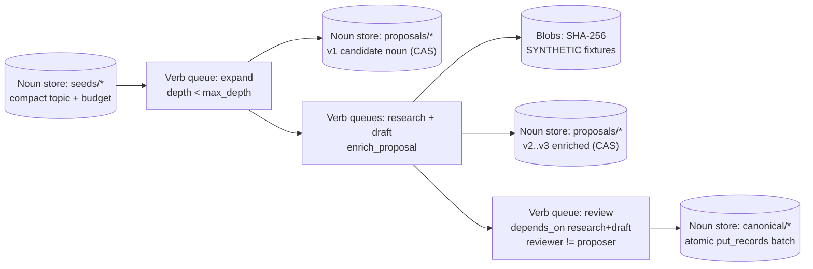

# Seeding & expanding atomic nouns and verbs with Muse / Meta agents

How a Muse Code agent, MCP client, or Meta Model API worker (`muse-spark-1.3`, `muse-wonder-1.0` in
Standard mode) safely **adds new atomic nouns and verbs and processes them end to end** without unbounded
fan-out or unreviewed store pollution.

For source-discovery meta-seeds and proposed daily collection, use the newer
[research seed authoring tool](research-seeds.md). It creates bounded worker
contracts on the same fabric. Its schedule stage creates a proposal noun; a
general recurring research scheduler is not installed by either workflow.

## Why dedicated `seed` and `expand` queues + staged noun stores?

If any swarm worker could recursively spawn tasks on execution queues or write directly into canonical
stores (`shamash` statute cards, `eranos.catalog` NGO kits), two failure modes appear immediately:

1. **Runaway fan-out:** an agent splits tasks that split tasks indefinitely, burning donated or budgeted
   tokens.
2. **Canonical noun pollution:** a single model pass overwrites verified records without independent review.

Tessera keeps the kernel (`src/tessera/`) 100% domain-neutral while organizing swarm growth into **four
bounded verb stages** paired with **three compare-and-set noun stores**:



## The three expansion noun stores

| Store | Key shape | Who writes | Guarantees |
|---|---|---|---|
| `seeds` | `<seed-id>` | Operator or seed-scoped intake key (`expected_version=None`) | Holds the topic, target namespace (`shamash.harm_pack`, `eranos.kit`, etc.), safety rules, and explicit fan-out budget (`max_depth` ≤ 3, `max_children` ≤ 8) |
| `proposals` | `prop-<seed-id>` | Proposer & enricher workers (`expected_version=None` then `1, 2, ...`) | Staging noun enriched across child verbs using compare-and-set so concurrent workers never clobber one another; records `proposed_by_worker` and content-addressed `blob_sha256s` |
| `canonical` | `<namespace>:<proposal-id>` | Independent reviewer (`reviewer != proposed_by_worker`) | Published only through a single atomic `put_records` batch that marks `proposals/<id>` `promoted` and creates `canonical/<ns>:<id>` together |

## How a Muse or Meta-powered agent connects

Every door shares the same hashed `tsk_*` keys (`make seed` writes scoped keys to
`~/.config/tessera/keys-tessera.json`, mode `0600`):

1. **Over MCP (`/mcp`, Streamable HTTP):**
   - **Verb tools:** `queues`, `enqueue`, `claim`, `heartbeat`, `submit`, `split`, `park`, `resume`
   - **Noun tools (`store` scope):** `put_record`, `put_records`, `get_record`, `record_history`
2. **Over HTTP (`/v1/*`) or Python (`tessera.client.Client` / `tools/swarm_expander.py`):**
   - Calls Meta's Model API Responses endpoint (`MODEL_API_BASE`, default `https://api.meta.ai/v1`) with
     `muse-spark-1.3` or `muse-wonder-1.0` in **Standard mode** (`*-contributor` model ids are refused in
     code before any request).
   - Registers each background model call against the active Tessera lease (`POST /v1/jobs` /
     `register_job`) and records token usage on completion (`update_job`).

## Run it end to end

```bash
# 1. Offline deterministic verification (no API key needed):
make expand-demo

# 2. Seed a local Tessera instance and run against the live HTTP service:
make seed
TESSERA_URL=http://127.0.0.1:7700 TESSERA_KEY=<muse-web-01-key> \
  MODEL_API_KEY=<meta-standard-key> \
  uv run python tools/swarm_expander.py --worker muse-01 --queue expand
```
