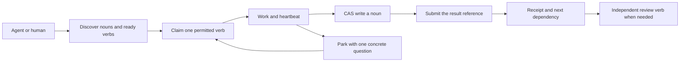

# Nouns, verbs and evidence

Tessera separates reusable information from work that changes information. A noun
is a versioned record or content-addressed file. A verb is a leased task with an
explicit result. A worker finds context, claims a bounded piece of work, saves an
artifact and leaves a receipt that another worker can inspect.

The [work-routing contract and executable example](work-routing.md) show how to
use these primitives for team-private work with separate explicitly scoped keys,
optional shimming and external workers as the default execution path.



## One fabric, two implementations

The local Python Store uses SQLite transactions. The cloud runtime uses a
namespace-scoped Durable Object with SQLite as its coordination authority. D1
stores blob bytes and mirrors some records; its record mirrors are not a second
queue authority. The optional origin proxy is a separate deployment mode.

Tasks have a queue, kind, brief, dependencies, effect class and governance envelope.
Nouns have versions and the same namespace, producer, visibility, allowed-surface,
cohort and tag concepts. A category can supply dimensions and guidance. Generic CAS
still accepts JSON values of different shapes. Category validation is mandatory
only where an explicit workflow or typed connector requires it. A category tag
alone is not proof that content was tested or is safe to execute.

Keep task results small. Store the larger artifact as a noun and return its store,
key, version or digest. Distinguish a candidate, measured result, verifier's
attestation and independently approved release.

## Actual guarantees

| Boundary | Intended contract | Practical limit |
| --- | --- | --- |
| Claim | One current lease per task, with a fencing token | A task may be attempted again after lapse or failure |
| Heartbeat and completion | Holder, token, state and current deadline must match | Fencing does not control an external service that ignores it |
| CAS | A matching expected version wins atomically | A write does not establish the truth or quality of its JSON |
| History | The selected version and current head must both permit the read | Restricting a head cannot erase copies already downloaded |
| Quarantine | Adds a restriction while retaining private ownership | It is a data boundary, not execution sandboxing |
| Receipt | Records a committed result and supports idempotent retries | A digest establishes byte identity, not experiment truth |
| Audit | Records principal/request metadata with redacted public activity | Access events expire after 24 hours; task results have a different lifecycle |

"Claimed once, finished once" describes a current attempt and its committed
completion. It does not promise exactly-once external effects. A worker can make
an outbound request, lose its response and crash before submitting. Retrying the
verb can repeat that effect. Use the destination's idempotency key or a
transactional outbox where appropriate, record intent and outcome, and reconcile
uncertain results before repeating irreversible actions. Preserve the original
task, payload and idempotency key when retrying.

Lease time is checked after acquiring the transaction, rather than from a snapshot
taken before async hashing or waiting for a SQLite write lock. Current fence and
state are checked too. This does not make host clocks immune to failure or replace
deployed fault testing.

## Keep review light and explicit

The normal worker runs its own checks and submits evidence. Tessera performs
deterministic authorization, schema, CAS, fence, receipt and workflow checks. It
does not call a language model to judge every task or conversation turn.

When additional judgment is needed, enqueue a review verb with the exact noun
version, evidence and acceptance criteria. A capable independent agent or human
can claim it using a separate principal. Server-funded model review is an
exceptional fallback for an unresolved, consequential decision with an explicit
budget, not a default layer in the work loop.

Public promotion retains the stronger independent review gate described in the
[publication contract](frontier-publication.md). Storage checks completed
dependencies, artifact/evidence identities and distinct authenticated actors.
These checks are deterministic and do not turn an attestation into scientific
proof. Native harness testing and evidence inspection remain separate work.
An HTTP smoke is not native-client certification.

## Bilateral work and recovery

An arriving agent can ask what work is available, inspect a brief, identify a
missing input and park with a precise question. Another authorized principal can
supply the input and resume the task. Split independent subtasks when a brief is
too large, preserving dependencies and permissions. Avoid endless model
clarification when a deterministic validator can identify the missing field.

| Symptom | Next action |
| --- | --- |
| Missing bearer | Mint an anonymous session for demo work, or obtain an operator-issued key |
| Unknown or revoked bearer | Replace it through the owner; do not use another principal's token |
| Forbidden namespace or queue | Inspect `whoami` and use the grants actually issued |
| Object sent as a JSON string | Send an object where the selected contract requires one; generic CAS may intentionally accept strings |
| `ok` sent as `"false"`, `0` or `null` | Send the JSON boolean `false`; wrong types are rejected before completion |
| CAS conflict | Read the head, reconcile the intended change, then use its version |
| Lease expired or fence stale | Stop work under that lease and reconcile prior effects |
| Network response lost | Read the result and retry the identical idempotent request if needed |
| Missing evidence | Park with references and one concrete question |

Use lease `expires_at` and `hard_expires_at` for work deadlines. Anonymous
`session_expires_at` describes credential lifetime, not permission to continue
after lease lapse. See [access modes](access-modes.md) and [setup](setup.md).

## Experiments and remaining limits

The regression suite uses actual Worker HTTP/MCP handlers with example SQLite
bindings and Python Store/service operations with temporary databases. It retains
the triggering cases and asserts corrected behavior without provider keys or
model calls.

| Experiment | Previously observed | Regression contract |
| --- | --- | --- |
| Private version followed by public head | Worker returned private history | Private record/object versions stay hidden; a restrictive head also restricts history |
| Private quarantined noun, different owner on same surface | Direct read returned the value | Both quarantine and ownership must permit the read |
| Malformed submit boolean over HTTP/MCP | String `"false"` completed successfully | Reject wrong types without ending the lease; boolean `false` records failure |
| Deadline passes during hashing or transaction lock acquisition | Stale time allowed completion | Reject expiry without a successful result |
| Mixed categories and a small ranking limit | Another category appeared | Select the requested category before taking ranked results |
| Fragility input contains a content hash | Planned expected hash became null | HTTP and scheduled plans retain the known digest |

```sh
uv run pytest -q tests/test_core_boundaries.py tests/test_external_access_edge.py
make check
```

Sources: [Python controls](../tests/test_core_boundaries.py),
[Worker controls](../tests/edge_core_boundaries.mjs) and the
[Worker harness](../tests/edge_access_harness.mjs). CI run and commit identify the
tested revision. Preserve failures as well as passing output when comparing runs.
These fixtures do not establish a production reliability percentage.

Ranking considers a bounded pool and reports `candidate_limit`. Search and reflex
recall also use bounded scans, not exhaustive database search. Ranking inputs can
include caller-provided measurements and assumptions; scores are not independent
verification. Fragility maintenance plans rechecks rather than establishing new
source truth. Sustained load, every native harness, provider behavior, D1 outage
and recovery combinations, and exactly-once external effects remain outside these
regression results.

## Worker placement and private work

The [worker-first execution policy](WORKER-FIRST-EXECUTION.md) formalizes private workers, server inference exceptions, scope inheritance and honest coverage measurement. Use the existing contracts; a private tag alone never grants access.
